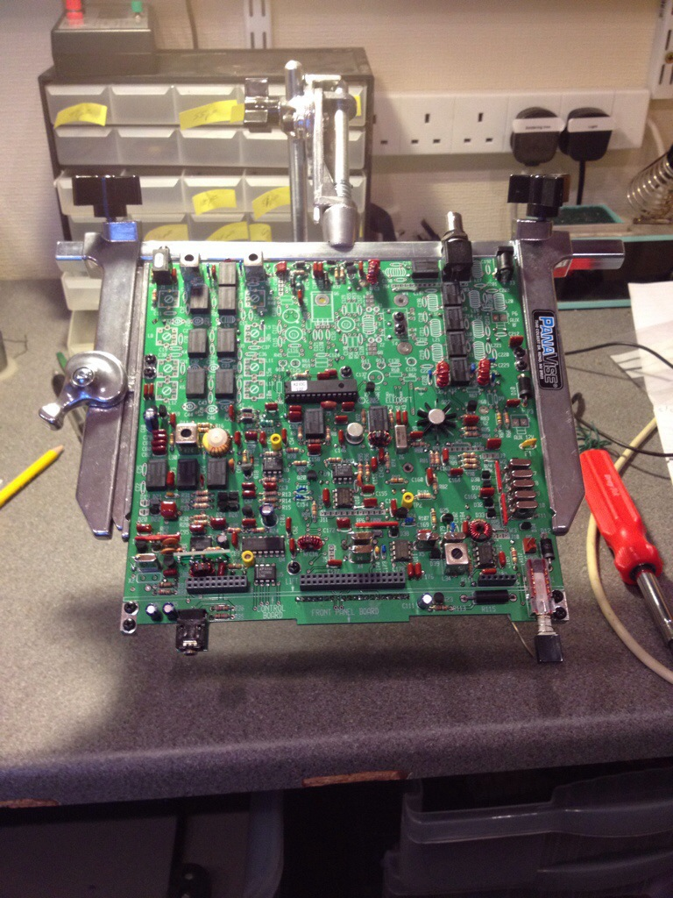

OK, almost without realising it, I got to the end of page 55, turned
over, and found that, in theory anyway, I have a working 40m all mode
receiver. There are some tests to run through, but the first phase is
reaching completion.
