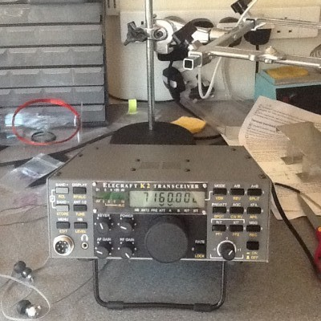

At least as far as the basic unit anyway.

After getting over the VCO problem, I\'ve been able to make steady, if
slow, progress towards completion. The filters are only roughly peaked
because I don\'t have an RF signal generator. I will rectify that later
as my next project is to build an RF signal generator controlled by an
Arduino.

I still have a number of option modules to build and install: KSB2, KAT,
KNB2, KIO2, KBT2 and KDSP2. None are too difficult and I can pick those
off at my leisure.

 
