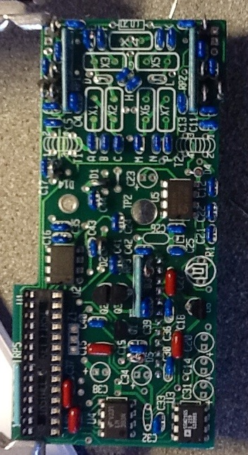

After a brief break due to some International travel, I\'m back in
builder mode again. This time it\'s the SSB adapter for the K2. My CW is
still very rusty and not to be trusted on the air waves, so I really
need SSB to make good use of the K2.\

This picture shows the partially completed board on the bench. The KSB2
is a lot tighter than the main K2 boards and requires a steady hand when
soldering. There aren\'t any SMD devices luckily, but some components
are mounted very close together.
