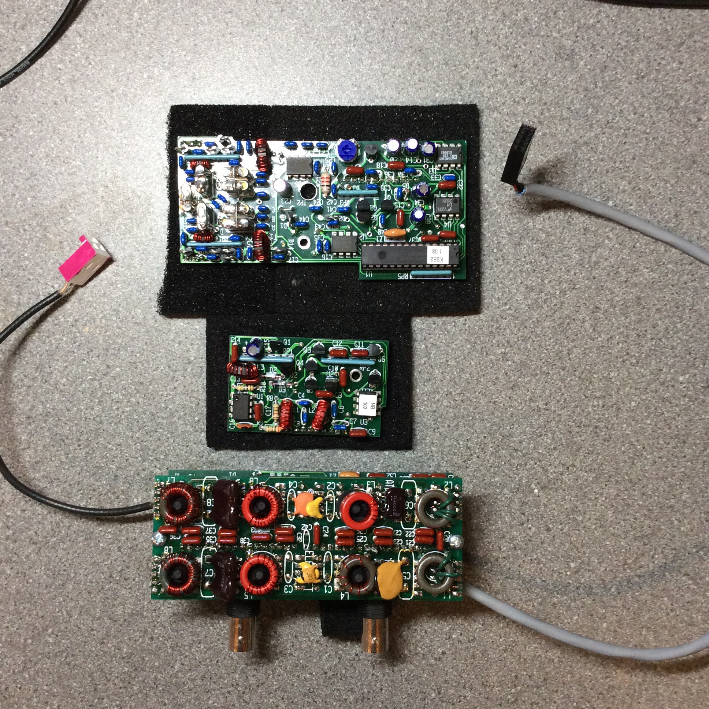

After a break, I\'ve been back building more K2 modules. I\'ve built the
KIO2, KNB2, KDSP2 and KAT2 modules over Christmas. That\'s the lot.

All but the KATU module worked straight away, but I\'ve got a problem
with the latter. I\'ve still got to resolve the lack of Mic gain on SSB
and absence of RF on 20m before I try and debug the ATU.

The picture shows the KDSP2, KNB2 and KAT2 modules. The KIO2 is already
attached to the top cover of the radio.
