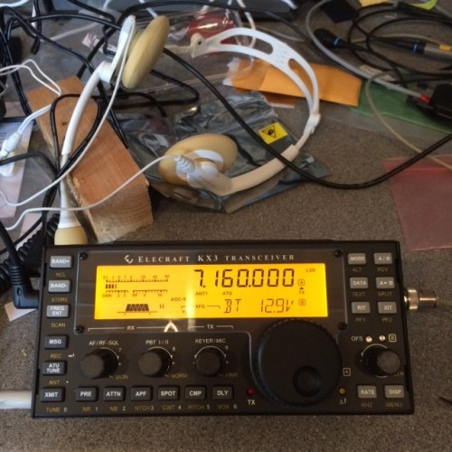

After receiving quite a good annual bonus, I looked at my wish list and
decided to buy a new portable HF radio. Based on my massive satisfaction
with the Elecraft K2, the decision was quite easy really. Yes, I\'ve
joined the KX3 brigade.

I ordered it in kit form from [Waters &
Stanton](http://www.wsplc.com "WSPLC") on Good Friday
and it appeared at my front door the following Tuesday. I reckon it took
about 3 and a half hours to assemble. Why would anybody buy it
assembled?

Included in the purchase were the KXFL3 roofing filter, KXAT3 internal
ATU and KXBC3 battery charger. I also bought the MH3 microphone.

I debated about the ATU and charger as I will mostly be using this
portable. I nearly always use tuned antennas when portable and I will be
using a LiFePo4 battery pack for external power. That said, there are
bound to be occasions when I would like to tune up a piece of string;
and I\'m nervous about taking the (homemade) LiFePo4 4S1P pack through
airport security. So, I may end up using some Panasonic Eneloop Pro 2450
mAh NIMH batteries for overseas activations.

First impressions are excellent. The receiver sensitivity is superb:
even better than the K2, which is pretty good.
