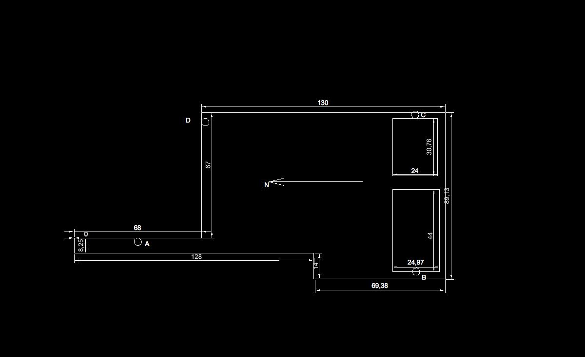

I started off by seeing how I could get the best from using the
fibreglass mast in the middle of the back fence. Unfortunately, the
internal angle would be too small for a dipole erected in a horizontal
Vee, so that left me with 13m to play with. Not much.

I could put a 30m dipole in (with the ends drooped) and could then have
20, 17, 15, 12 and 10m dipoles in a fan; but this would be a nightmare
to set up, and the weight would probably be too much for the fibreglass
mast . Also, conditions are still declining IMO, so I really want 40m
(at least).

Luckily, a change in the garden provided me with more options. We\'ve
just put in a new shed in the bottom SE corner of the garden, and this
gave me the idea of mounting a pole on the end of the shack (B on the
plan) and another on the end of the shed (C on the plan). Add in a stub
mast on the gable end (A) and I now have 36m to play with (albeit in an
odd shape). Plus, the middle is roughly above the shack (see plan).

## 80m Doublet

This led me to the antenna I am actually building: an 80m doublet (with
one drooped end) fed with ladderline from the shack. One side runs in a
straight line from the gable end (A) to the shack (B). The other runs at
right angles to the shed (C) and then back to the house (D). I\'m going
to model this to see if there are any reasons not to follow this path,
but it looks good.

## Tuner

The problem of course is that I really need a balanced tuner for this to
work. Even without modelling, I foresee that the feedline will be
unbalanced because of the odd shape. Putting this straight into an
unbalanced tuner would be foolish. However, I do have the SG-230.

What I am doing is to install a 1:1 Guanella (Current) Balun on the end
of the ladderline and connect the unbalanced output direct to the
SG-230. The Balun should force the ladderline to be balanced and reduce
radiation from the ladderline.

Provided the impedance swing is not beyond the capabilities of the
SG-230 (and I\'ve no clear idea of what those are), this should work. As
the tuner will now be \"hot\" I\'m installing an RF Choke on the coax
from the tuner to kill any RF that wants to go down the outside of the
shield.

The next part will cover building the antenna.
