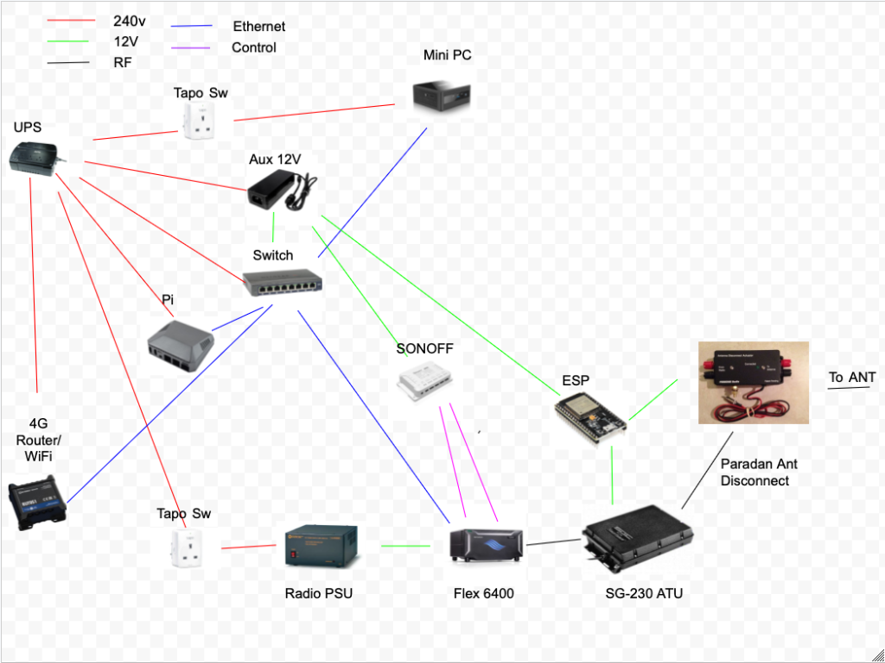

Hopefully the image above should help to understand what the station
consists of. The station comprises:

- A 240V network with the UPS at its core and feeding:

  - two Tapo switches (one for the PC and one for the Radio PSU);

  - the permanently-on auxiliary 12V PSU that powers the  Sonoff, network
    switch and the ATU controller; and,

  - the permanently-on PSUs for the Router and the Pi-based Station
    Controller.

- A mixed wired and WiFi network connecting most devices.

  - The main Radio PSU - Flex - ATU - Antenna Disconnect RF chain.

  - The Sonoff that switches the Flex on and off and operates the PTT when
    needed.

- The Pi-based Station Controller running Home Assistant.

- The Windows 10 PC used for digital modes.

I hope this all make sense.

Moving on, the station has been operating from my home QTH for some time
now whilst I scout out a suitable remote location. I\'m glad to say that
a local farmer has agreed to let me site the station on their land. The
only downside is that the station needs to be outside, so I now need to
source a suitable IP65 or IP66 (but ventilated) wall-mounted cabinet to
house it all in. Not easy to find!

For the antenna, there is a convenient line of trees close by and a 10m
high barn; to which they have agreed I can mount a 20m pole to be one
end of the doublet antenna I intend to use - the other end being one of
the trees. With luck I\'ll be able to erect a decent doublet at 20m off
the ground and fed by balanced feeder from the SG-230; which will be
mounted 2-3m off the ground at a convenient location midway between the
ends of the doublet - probably somewhere on the wall of the
aforementioned barn. I\'ll use a 12V combiner to feed power to the ATU
and the antenna disconnect unit.
