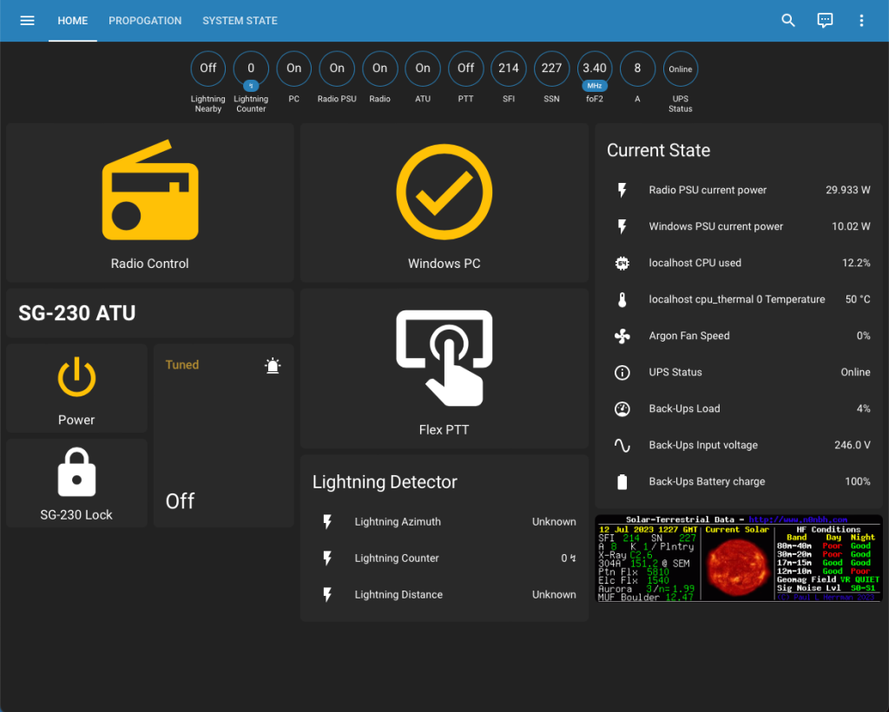
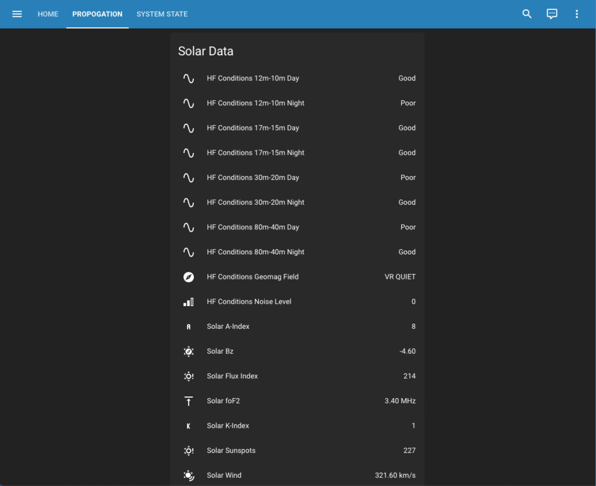
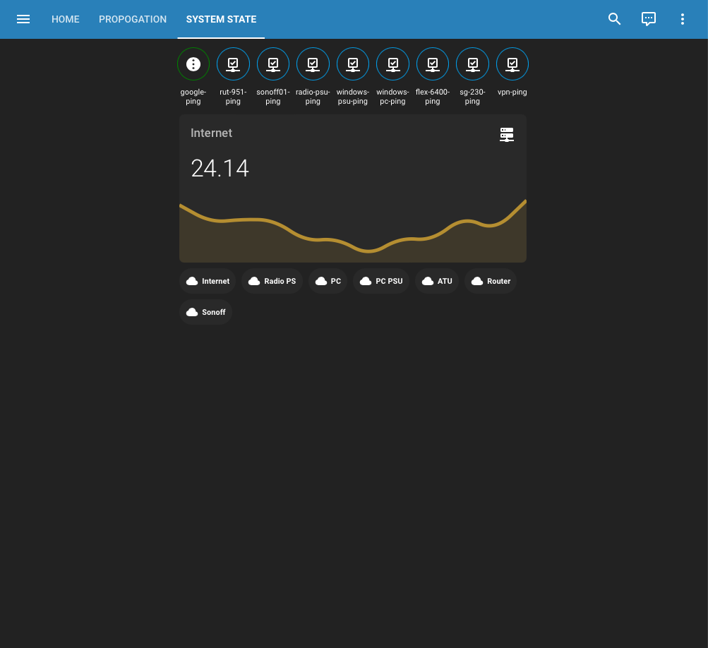

I thought I\'d add some screenshots of what the control UI looks like.

The one above shows the main screen with the various controls on it.
Only two need to be touched in normal circumstances: the Radio Control
button and the Windows PC button. These both kick off automations that
sequence through turning things on or off - they don\'t control things
directly.

At the top of the screen are a number of tell-tales that indicate the
state of various components, plus basic propagation information.

You can also see the lightning detector and some elementary status info. If Blitzortung reports lightning within 25km, a script runs that sends a
Pushover alert, waits a couple of minutes and then kicks off the Radio
Power Off script as if the user had tapped the Radio Control button.

Lastly you can see the state of the ATU, you can toggle the Lock
function on the ATU to disabled the auto-tune function, and see whether
it is tuned or not.

 
This image shows more comprehensive propagation info.

Lastly, you have a screen with some system status information.

There are more screens accessible via the side menu bar, but these three
cover 90% of what\'s needed. I\'ve seen some remote control screens that
are, in my opinion, far too crowded with irrelevant information. All
that does is hide important information and controls and overwhelm the
user with noise. (again, my opinion).

Incidentally, all these screens are produced using the standard controls
provided with Home Assistant, plus some useful ham-related plugins (e.g.
Blitzortung and HF Propogation)
