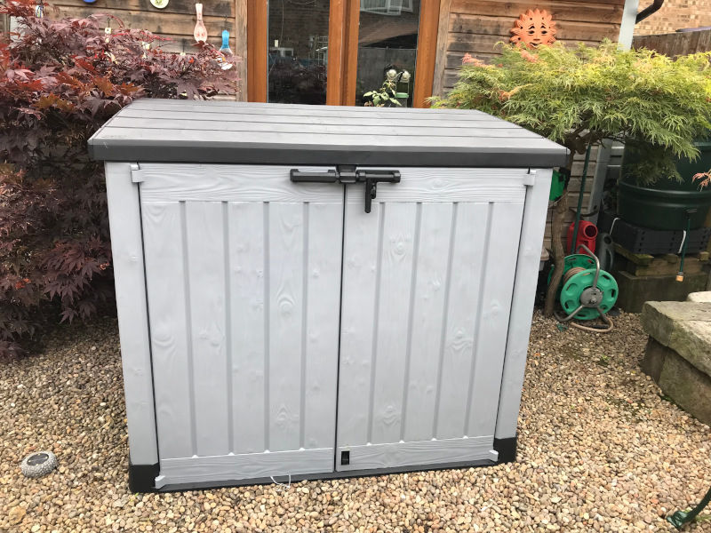
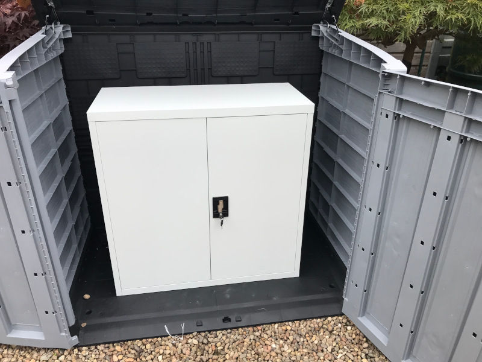

I now have the cabinet in which the station will be housed at the remote
site. I looked at \"designed\" solutions for environmentally controlled,
waterproof, secure external housings, but we\'re talking loads-a-money.

Luckily, my wife suggested the above: a \"secure\" metal office cabinet
inside a plastic wheely bin cabinet.

The latter is mainly for protection against the elements. We have
something similar for general storage in the garden and we\'ve never had
a problem with rain penetration. In any case, the equipment will be
sealed in the inner cabinet, so a little bit of seepage shouldn\'t be a
problem.

The next task is to build it up to be, as far as possible, a
self-contained and self-managing remote station that needs as little
attention as possible whilst being fully accessible and controllable
from home.
