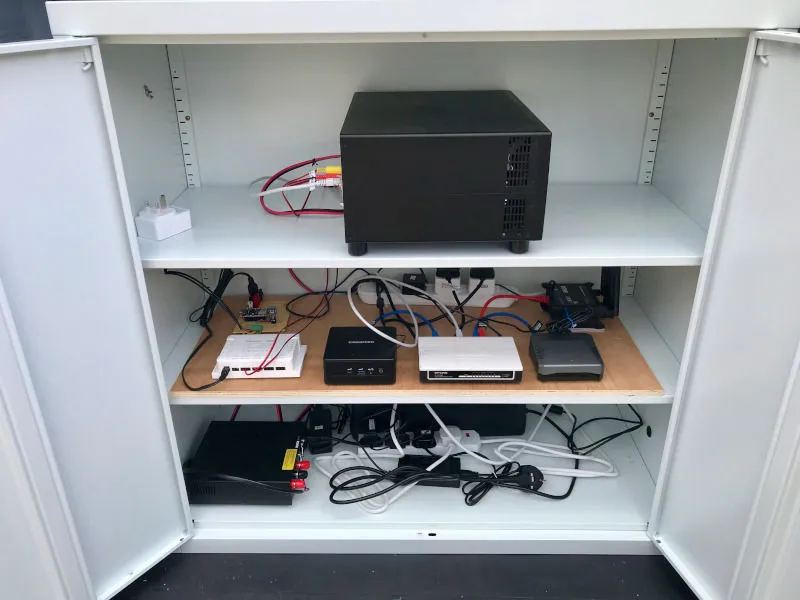
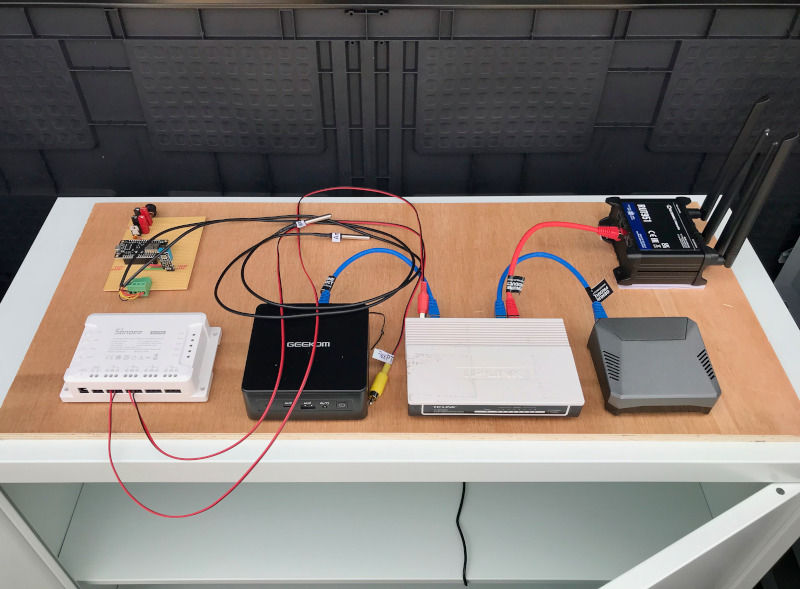

The main image shows the installed station - but still in the garden.
The top shelf has the Flex 6400 on it, the middle shelf the control
system and the bottom has the UPS and power supplies. Hopefully, this
will cut down on noise induction.

This image shows the control board before being installed in the
cabinet.

Top left is the ancillaries board with an input jack from the ancillary
12V PSU, a couple of Power Poles to feed other 12V devices, the ESP8266
running ESPHome and code for the environmental sensors - an on-board
Temp/Humidity sensor for the internal cabinet, and two 1-wire
temperature sensors that will be placed in the space between the two
cabinets and outside. 

On the far right is the Teltonika RUT951 router.
In the picture it has its internal aerials on, but in the field it will
have the 4G antennas and one of the wi-fi antennas connected to external
antennas.

Below that is:

- The Sonoff 4ch switch which controls the Remote On/Off and PTT on the
  Flex, and the 12V power to the remote auto ATU (not shown)

- The Geekom Mini IT8 Windows PC

- The Netgear Ethernet switch, and

- The Raspberry Pi4 in its smart Argon One case.

Not shown in this image are any power leads. Also not shown in this
image, but visible in the main one, are the two Tapo wi-fi switches that
control the mains input to the main 12V PSU and the PC\'s PSU. The
switches are on the middle shelf in case the wi-fi doesn\'t penetrate to
the bottom shelf. I\'m going to try them in the bottom today.

The station is now built, but I\'m going to leave it in the garden for a
week or so to accumulate sensor readings so I can decide if I need to
add forced cooling. It will be located against a north facing wall, so
won\'t get any direct sun. It\'s in a similar north-facing position in
the garden, but will get a bit of early morning and late afternoon sun
for the next week or so.
