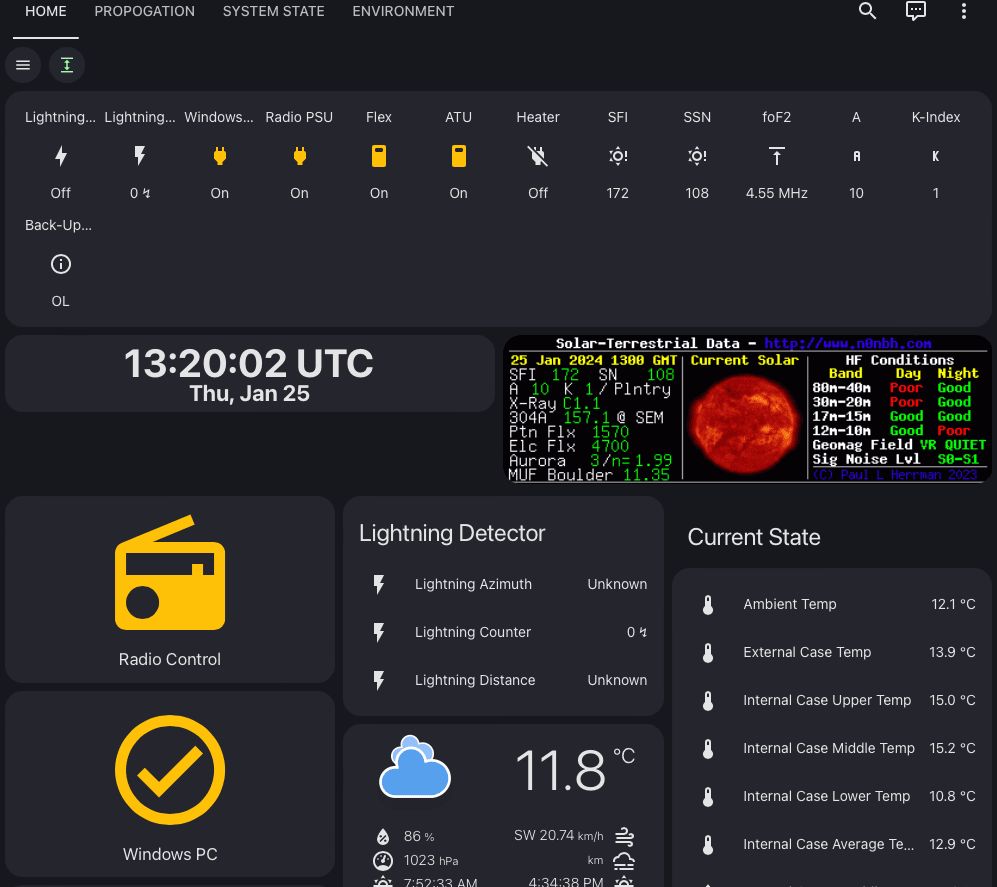
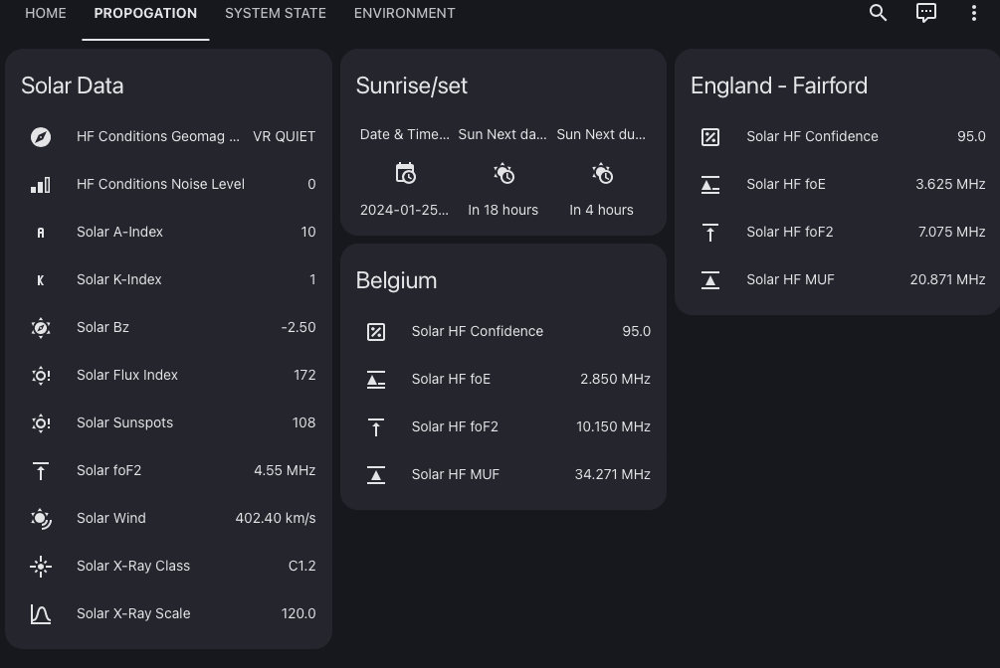
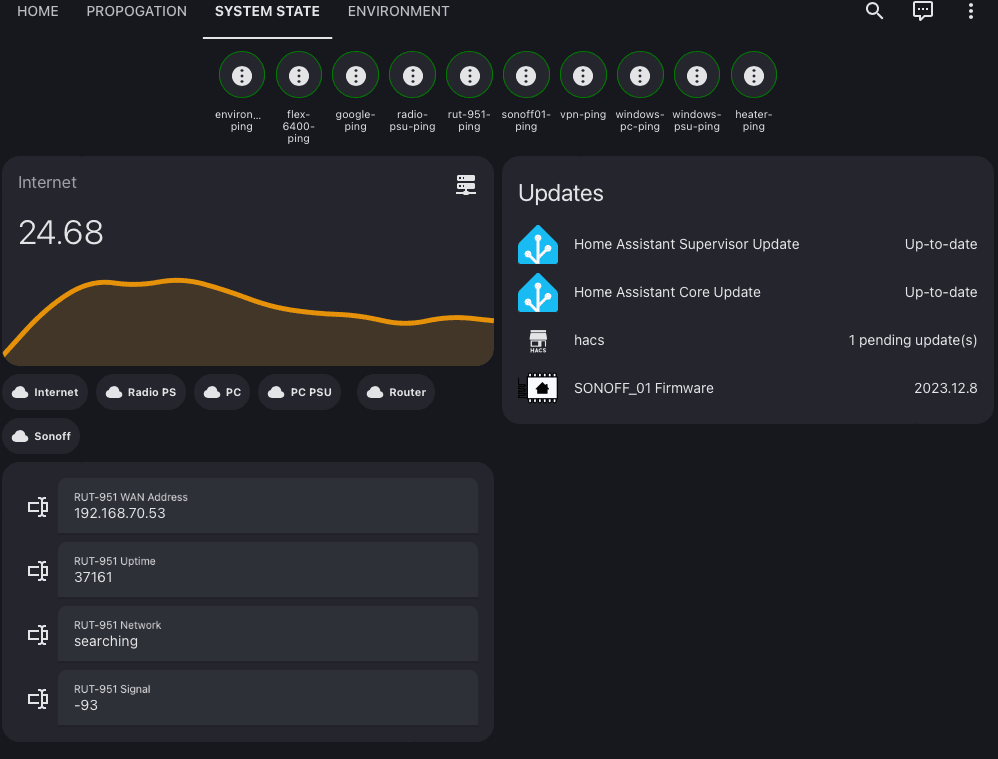
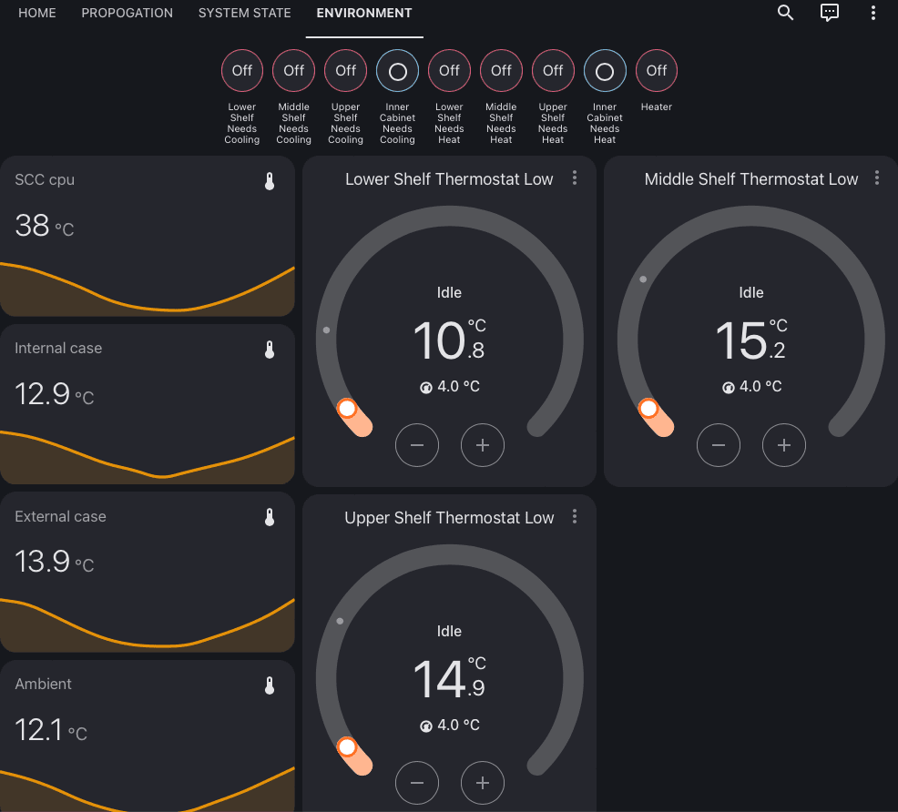

As I've been "playing" with it a bit, I thought I'd post some updated
screenshots of the control system I use for the remote station. As a
reminder, I use a Raspberry Pi 4 running [Home Assistant
OS](https://developers.home-assistant.io/docs/operating-system/ "Home Assistant OS")
and [Home Assistant](https://www.home-assistant.io "Home Assistant").

There are four tabs on the screen for: Overall status and control;
Current and recent propagation conditions; more system status
information; and environment conditions at the remote station.

In addition, there are special screens showing more detailed information
and diagnostics should they be needed.

_Home Screen_

_Propagation Screen_

_System State Screen_

_Environment Screen_

The last screen looks more complex than it needs to be because I have
been playing with the system to optimize the temperature and humidity in
the cabinet. Once I\'m done, I\'ll hide the various thermostats because
they\'ll never be adjusted by a user.
