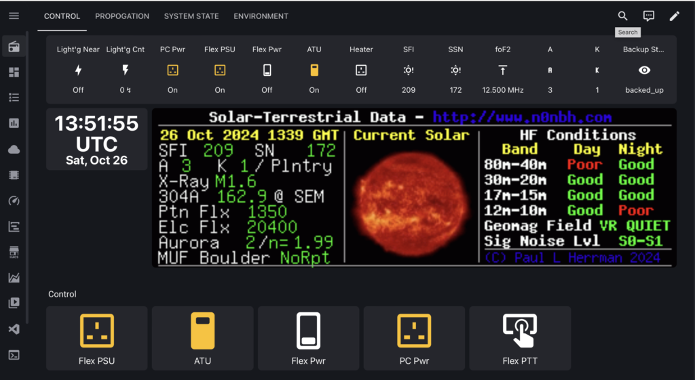
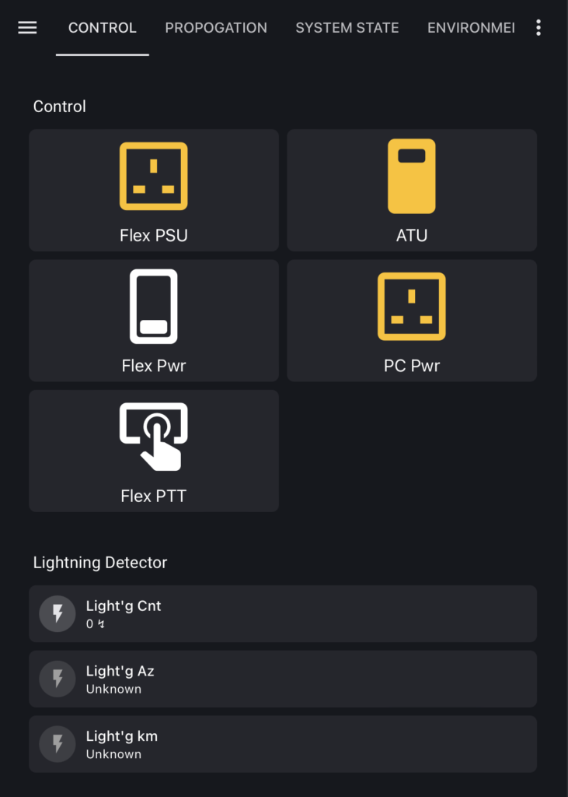
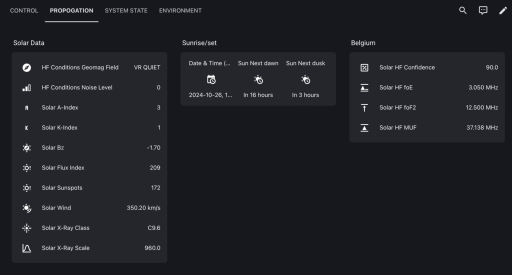
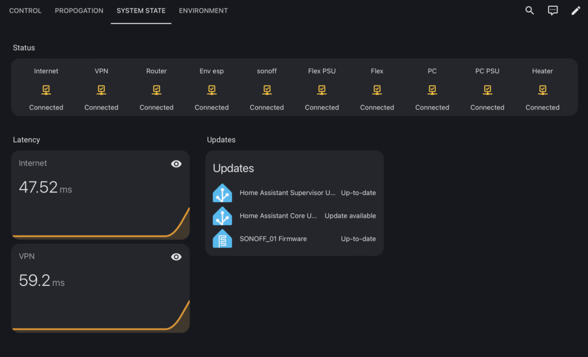
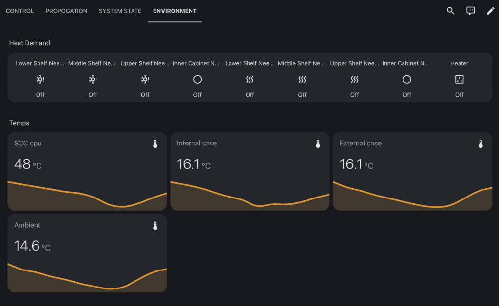
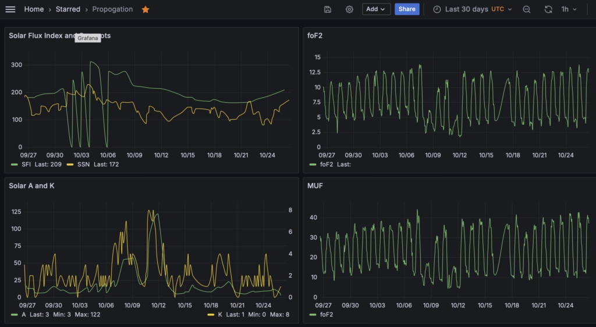

I thought I'd post some updated screens from the Raspberry Pi that
monitors and controls the remote station.

By way of a refresher, it's a [Raspberry Pi
4](https://www.raspberrypi.com) in an [Argon
One](https://argon40.com/products/argon-one-v2-case-for-raspberry-pi-4)
case and running [Home Assistant](https://www.home-assistant.io). The
SCC does the following:

- Provides a control surface for the main 12V power supply, the Flex
  itself, the remote ATU and the Windows PC
- Monitors the state of the various switches and sensors in the remote
  shack
- Controls the heating and cooling for the cabinet
- Alerts me to various conditions
- Does its best to protect the entire system when the going gets tough
  :-)

So, on to the images.

## Control Screen

_Control Screen on Desktop_

This is the main control screen as seen from a desktop or laptop. At the
top are various status indicators, followed by the time and current
propagation and then buttons to control the Flex PSU, the ATU, the Flex
6400 and the Windows PC that I use for digital modes.

The final button allows me to toggle the PTT line on the Flex. This is
needed if you change the SmartLink configuration.

_Control Screen on Mobile_

All windows are dynamic, depending on the browser viewport. This image
is the same screen, but seen on a mobile device. Basically, it removes
unnecessary elements.

## Propagation Screen

_Propogation Screen_

The next screen displays more detail on the current propagation state.

## System State Screen

_System State Screen_

Next is a screen showing various indicators about the system state. Some
of this is a repeat of what\'s on the Control Screen.

## Environment Screen

_Environment Screen_

The inner cabinet has temperature sensors on each shelf, plus sensors
for the temperature in the external cabinet and outside. Home Assistant
uses these with virtual thermostats to control a heating element and
cooling fans in the inner and outer cabinets.

In extremis, Home Assistant will shut down the radio if things are
getting too hot. It will alert me using Pushover if it's getting too
cold, so that I can (e.g.) switch on the Power Supply and (maybe) the
Flex to warm things up.

## Grafana

_Grafana_

All sensor values, system state changes etc are logged to an Influxdb
database, from where it can be displayed using Grafana.

This screen shows propagation history, and there is another displaying
temperature and humidity changes.
s
