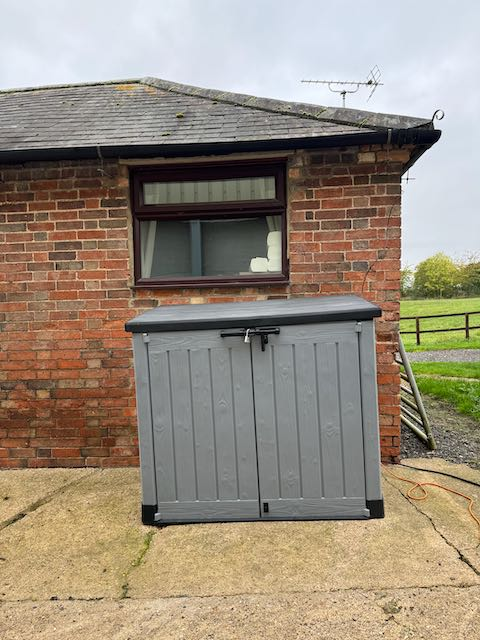
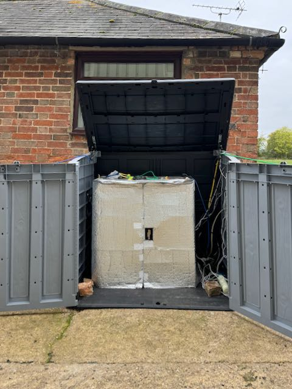
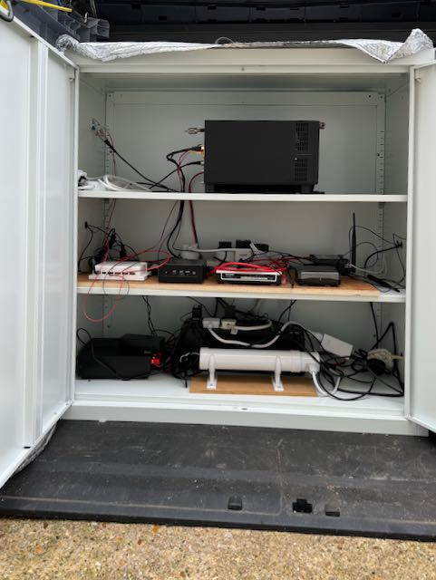
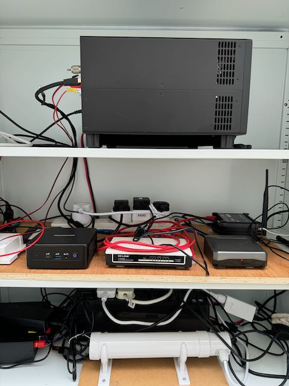
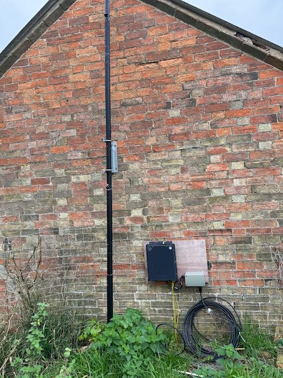

Here are some updated photographs of the remote shack.

_Outer Cabinet in situ_

This is a general view of the outer cabinet at the farm. Yes, it is on a slight slope.

_Inner Cabinet_

With the outer doors and lid open, you can see the inner cabinet in its bubble-wrap blanket.

_Inner Cabinet with doors open_

With the inner doors open you can see the internal layout.

_Inner Cabinet detail_

On the bottom floor is the radio's power supply, the UPS and the
cabinet heater. Above that is the control board with all the
electronics; and above that the Flex.

_Antenna_

A not particularly interesting picture of the antenna; showing the
fiberglass mast and the ATU board with ATU and the box containing the
power take-off for the ATU.

Not shown in this picture is the antenna disconnect.
